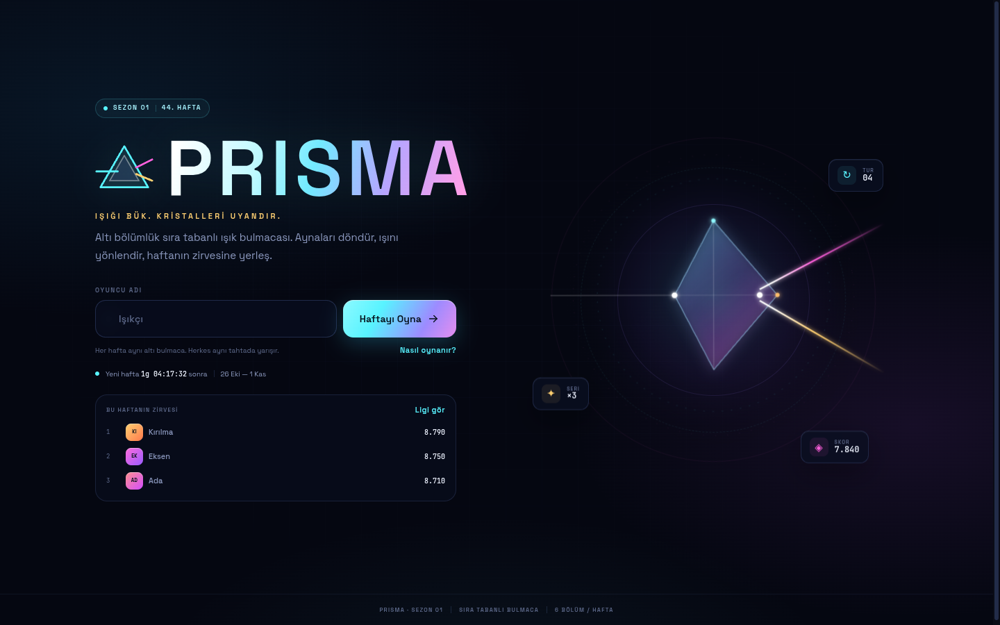
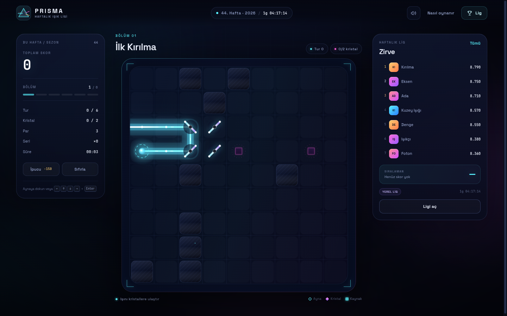
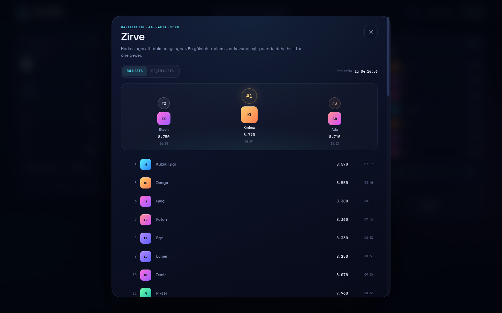

# PlayGround

<!-- omgithub:readme:start -->
## 🚀 Build, play, and remix with OMGithub

**Created using [OMGithub.com](https://omgithub.com).**

[](https://omgithub.com/onlysamet/PlayGround)
[](https://github.com/onlysamet/PlayGround)

- 🎮 [Open the project](https://omgithub.com/onlysamet/PlayGround).
- ✨ [Remix this project](https://omgithub.com/?remix=onlysamet%2FPlayGround).
- 💻 [Explore the source](https://github.com/onlysamet/PlayGround).
- 🛠️ [Check build runs](https://github.com/onlysamet/PlayGround/actions).
- 🐛 [Report an issue](https://github.com/onlysamet/PlayGround/issues).
- 👤 [Explore the creator's projects](https://omgithub.com/onlysamet).
- 🌍 [Create with OMGithub](https://omgithub.com).
<!-- omgithub:readme:end -->

# PRISMA — Haftalık Işık Ligi

**Işığı bük, kristalleri uyandır.** PRISMA, her hafta herkese aynı altı bulmacayı sunan, sıra tabanlı bir 2D ışık bulmacası ve haftalık skor ligidir.



## Nasıl oynanır?

- Kaynaktan çıkan tek ışını aynalarla yönlendir ve tüm kristalleri aynı anda uyandır.
- Her ayna dönüşü **bir tur** sayılır. Amaç az turda, yüksek puanla bitirmek.
- Altı bölümün toplamı haftalık skorunu belirler. Aynı hafta içinde en iyi skorun geçerli olur.
- Eşit puanda **daha hızlı tur** üst sıraya geçer.



| Girdi | Eylem |
| --- | --- |
| Aynaya dokun / tıkla | Aynayı 90° döndür |
| `←` `↑` `↓` `→` | Tahtadaki imleci gezdir |
| `Enter` / `Space` | İmlecin üstündeki aynayı döndür |
| `R` | Bölümü sıfırla (seri bozulur) |
| `H` | İpucu aç (−150 puan) |
| `L` | Haftalık ligi aç |
| `?` | Nasıl oynanır |

## Puanlama

Bir bölümün puanı:

```text
400 (bölüm temeli)
+ 120 × kristal sayısı
+ 140 × kullanılmayan tur (tur bütçesi − oynanan tur)
+ 300 (par turunda bitirince kusursuz çözüm)
+ 50 × bölüm serisi
− 150 × ipucu
```

Sıfırlama seriyi sıfırlar. Tur bütçesi aşılırsa verimlilik bonusu kapanır.

## Haftalık lig

- Hafta, **ISO haftası** ve **UTC** saatine göre hesaplanır; yeni hafta pazartesi **00:00 UTC**'de başlar.
- Altı bulmaca, hafta anahtarından deterministik olarak üretilir: aynı haftada herkes aynı tahtaları oynar.
- Varsayılan mod **yerel lig**dir: skorlar tarayıcıda saklanır, haftalık tempolu rakipler tahtayı canlı tutar.
- İsteğe bağlı sunucu ile **canlı lig** açılır: tüm oyuncular aynı sıralamada yarışır.



## Çalıştırma

Proje vanilla HTML/CSS/JavaScript ve ES modülleri kullanır; derleme adımı veya paket bağımlılığı yoktur.

Herhangi bir statik sunucu yeterlidir (ES modülleri için `file://` yerine HTTP gerekir):

```bash
python3 -m http.server 8000
# http://localhost:8000
```

Bu depodaki çalışma ortamında `start.sh` de kullanılabilir.

## Canlı lig sunucusu (isteğe bağlı)

Sıfır bağımlılıklı küçük bir Node.js sunucusu dahildir. Hem oyunu hem JSON API'yi sunar:

```bash
node server/leaderboard-server.mjs
# http://localhost:4173/?online=1
```

`?online=1` parametresi ligi `/api/leaderboard` adresine bağlar. Farklı bir adres kullanmak için `js/app.js` yüklenmeden önce şunu tanımlayın:

```html
<script>window.PRISMA_CONFIG = { leaderboardApi: '/api/leaderboard' }</script>
```

Sunucu seçenekleri:

```bash
PORT=8080 HOST=127.0.0.1 node server/leaderboard-server.mjs
```

Skorlar `.data/leaderboard.json` dosyasında tutulur (`.gitignore` kapsamındadır). Sunucu her oyuncu ve hafta için yalnızca en iyi skoru saklar; eşit puanda daha hızlı tur kazanır.

### API

```http
GET /api/leaderboard?week=2026-W44
```

```json
{ "week": "2026-W44", "entries": [{ "id": "…", "name": "Işıkçı", "score": 9110, "timeMs": 61000, "levels": 6, "crystals": 17 }] }
```

```http
POST /api/leaderboard?week=2026-W44
Content-Type: application/json

{ "id": "…", "name": "Işıkçı", "score": 9110, "timeMs": 61000, "levels": 6, "crystals": 17 }
```

Yanıt, güncel sıralamayı ve `improved` bilgisini döndürür. Bu ligde hesap doğrulaması yoktur; skorlar istemci tarafından gönderilir. Arkadaş grupları ve küçük etkinlikler için tasarlanmıştır, rekabetçi bir hile koruması sunmaz. İstemci, sunucuya ulaşamazsa yerel lige düşer.

## Proje yapısı

```text
index.html                 Oyun kabuğu, başlangıç ekranı, modaller
css/style.css              Neon cam arayüz ve duyarlı düzen
js/app.js                  Oyun durumu, akış, puanlama, arayüz
js/puzzle.js               Deterministik bulmaca üretimi ve ışın çözücü
js/renderer.js             Canvas tahta çizimi ve efektler
js/leaderboard.js          Yerel lig, haftalık rakipler, API istemcisi
js/week.js                 ISO hafta, geri sayım ve biçimlendirme
js/audio.js                WebAudio ses sentezi
js/config.js               Çalışma zamanı yapılandırması
server/leaderboard-server.mjs  Statik sunucu + paylaşımlı lig API'si
assets/                    Favicon ve ekran görüntüleri
```

## Notlar

- Ses ve skor tercihleri tarayıcıda saklanır; oyun içi “sesi kapat” düğmesi kalıcıdır.
- Devam eden tur, sayfa yenilense bile kaldığı yerden sürer.
- `prefers-reduced-motion` desteklenir; hareket azaltıldığında animasyonlar sadeleşir.
- Mobilde dokunmatik tahta, masaüstünde fare ve klavye birlikte çalışır.
- Hata ayıklama: `?debug=1` parametresi `window.PRISMA_DEBUG` yardımcılarını açar.
